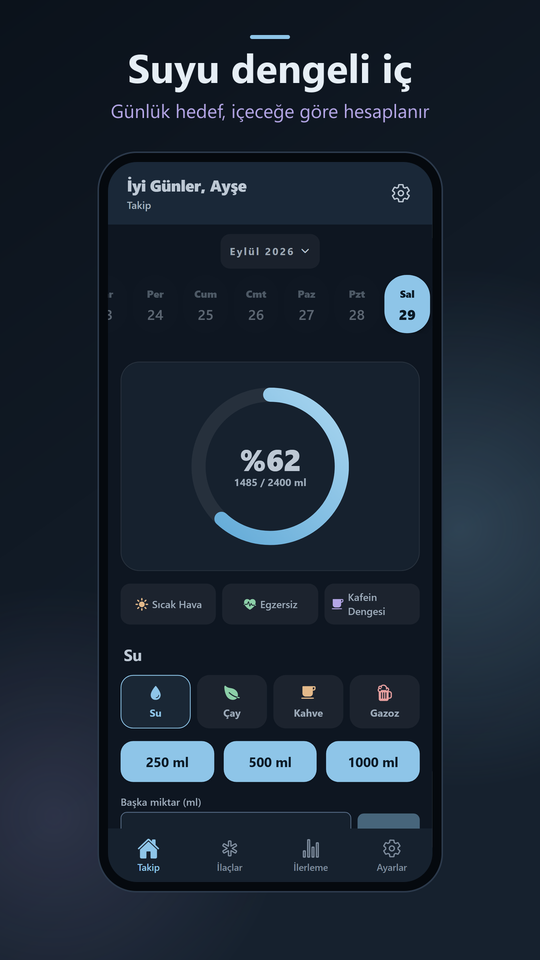
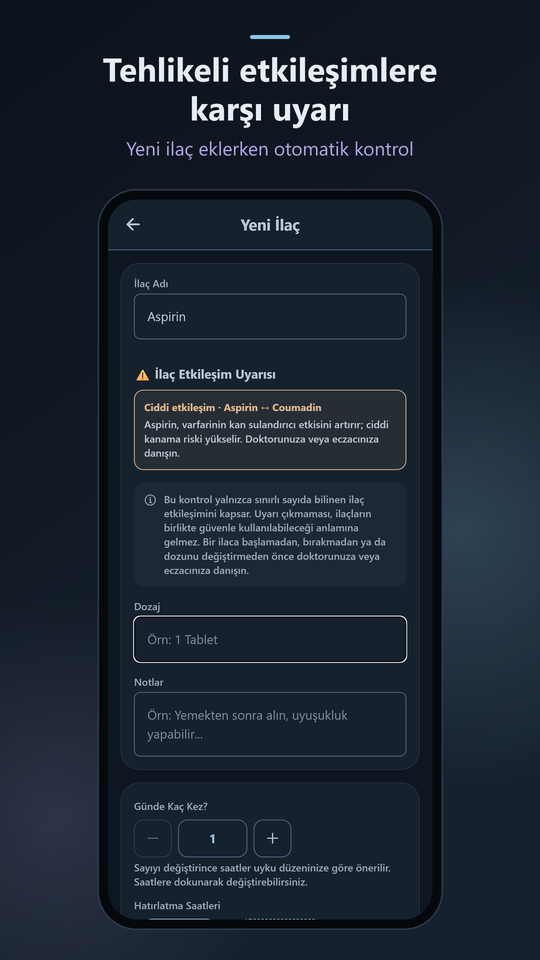
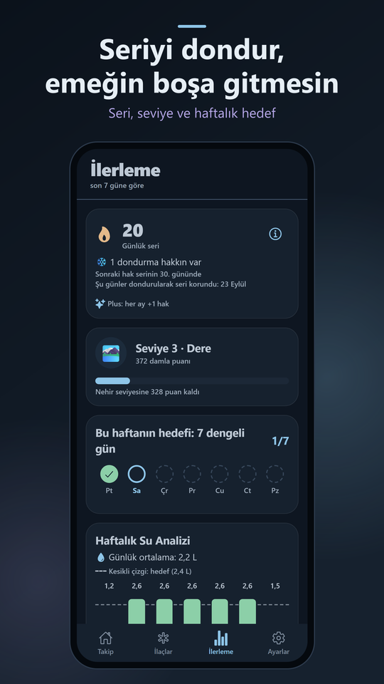
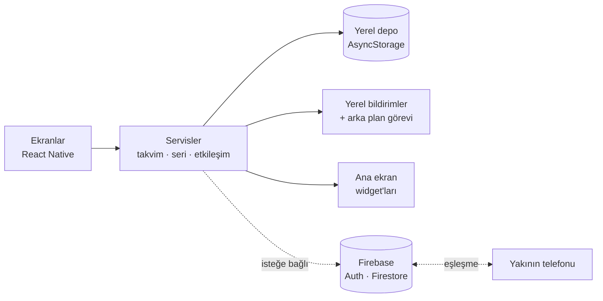

Hangi ilacı ne zaman alacağını ve gün içinde ne kadar su içtiğini takip eden Android uygulaması. Yaşlı kullanıcılar ve onlara göz kulak olan yakınlar düşünülerek tasarlandı: büyük yazı görünümü, sade ekranlar, bir yakının uzaktan takip edebilmesi.

> Google Play'de kapalı test sürümü hazırlanıp incelemeye gönderildi; mağazada yayında değildir.

<table>
  <tr>
    <td align="center"><br><sub>Su takibi</sub></td>
    <td align="center"><br><sub>Etkileşim uyarısı</sub></td>
    <td align="center"><br><sub>İlerleme</sub></td>
  </tr>
</table>

## Özellikler

| | Ne yapar |
|---|---|
| 💊 **İlaçlar** | Bir ilaca birden çok saat, doz ve birim; "Aldım / Atladım" bildirim düğmeleri; stok azalınca uyarı |
| ⚠️ **Etkileşim** | Yeni ilaç eklerken bilinen etkileşimleri kontrol eder, uygun saat önerir |
| 💧 **Su** | İçeceğe göre hesaplanan günlük hedef, hızlı ekleme, hatırlatmalar |
| 👪 **Yakın takibi** | Kodla eşleşen yakın, takip edilen kişinin gününü görür; doz kaçınca haber alır |
| 📄 **Doktor raporu** | 30/90 günlük ilaç uyumu ve ölçümlerden A4 PDF (TR/EN) |
| 📱 **Widget** | Ana ekranda bugünün özeti ve su durumu |
| 🌗 **Görünüm** | Açık/koyu tema, renk paletleri, büyük yazı kipi |
| 🔥 **Motivasyon** | Seri, seri dondurma hakkı, seviye ve haftalık hedef |

## Nasıl çalışır



Veri önce telefonda tutulur; uygulama çevrimdışı çalışır. Hesap açmak ve bulut yedeği isteğe bağlıdır. Yakın eşleşmesinde iki telefon yalnız Firestore güvenlik kurallarının izin verdiği belgeleri paylaşır.

## Kurulum

```bash
npm install
npx expo start        # geliştirme sunucusu
npm test              # Jest testleri
npm run typecheck     # TypeScript denetimi
```

`app.json` içindeki proje değerleri bu depoda boş ya da örnektir; **kendi değerlerinizi girin**:

- `expo.extra.firebase.*`: kendi Firebase projenizin web yapılandırması (boşken uygulama yerel kipte çalışır; eşleşme ve bulut yedeği kapalı kalır)
- `google-services.json`: proje köküne konur, depoya girmez
- `expo.extra.admob.*` ve `react-native-google-mobile-ads`: Google'ın herkese açık **test** reklam kimlikleri; yayın için kendi AdMob kimlikleriniz
- EAS: `eas init` ile kendi proje kimliğiniz

## Teknoloji

React Native · Expo · TypeScript · Firebase (Auth, Firestore, Crashlytics) · Expo Notifications · expo-print · Jest · EAS Build
